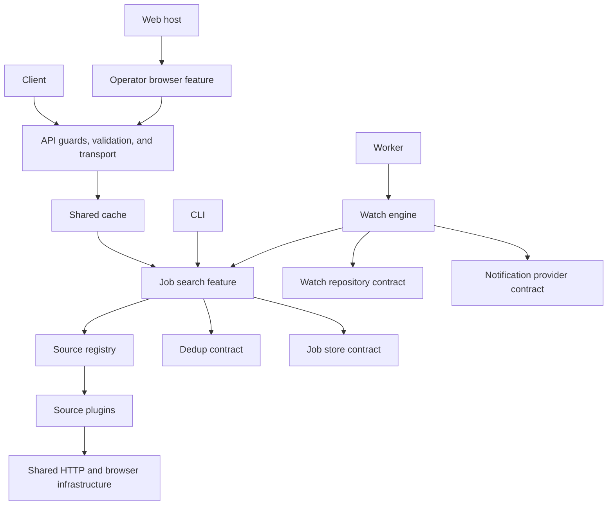

# Architecture overview

rad.ar hosts shared feature packages through NestJS applications and a browser plugin host.

## Why

The API, CLI, and watcher need the same search and watch behavior without depending on one another's source trees.
Shared contracts let applications select implementations without coupling plugins together.

## How it works

## Tech

- API authentication, throttling, logging, validation, HTTP errors, REST, and GraphQL adapters remain in the API app.
- Job search, aggregation, comparison, circuit-breaker policy wiring, and health snapshots belong to the job-search plugin.
- Watch execution, schedules, scoring, presets, and delivery orchestration belong to the watch-engine plugin.
- Memory and Prisma watch repositories and Discord, webhook, and Telegram implementations are separate adapters.
- Configuration, cache, metrics providers, HTTP, and browser helpers are shared infrastructure.
- The web app owns startup, routing, and the shell; operator pages and feature components use a browser-only package entrypoint.

## Key files

- [Application composition](../apps/api/src/jobs-composition.ts)
- [Search feature](../packages/plugins/job-search/src/job-search.module.ts)
- [Watch feature](../packages/plugins/watch-engine/src/watch-engine.module.ts)
- [Browser host](../apps/web/src/app.tsx)

## Decisions and gotchas

The source inventory and runtime registry determine the current source count.
Configured source disablement is applied during discovery at startup.
Transport modules re-export the services and circuit-breaker providers their controllers consume.
The HTTP cache stores raw search results before per-request deduplication and persistence.
The watcher maintains its existing leases, initialization rules, outbox, and retry behavior.
The repository uses one lockfile covering application, shared, and nested plugin workspaces.

## Related

- [Project structure](project-structure.md)
- [Plugin architecture](plugin-architecture.md)
- [Identifier migration](identifier-migration.md)
